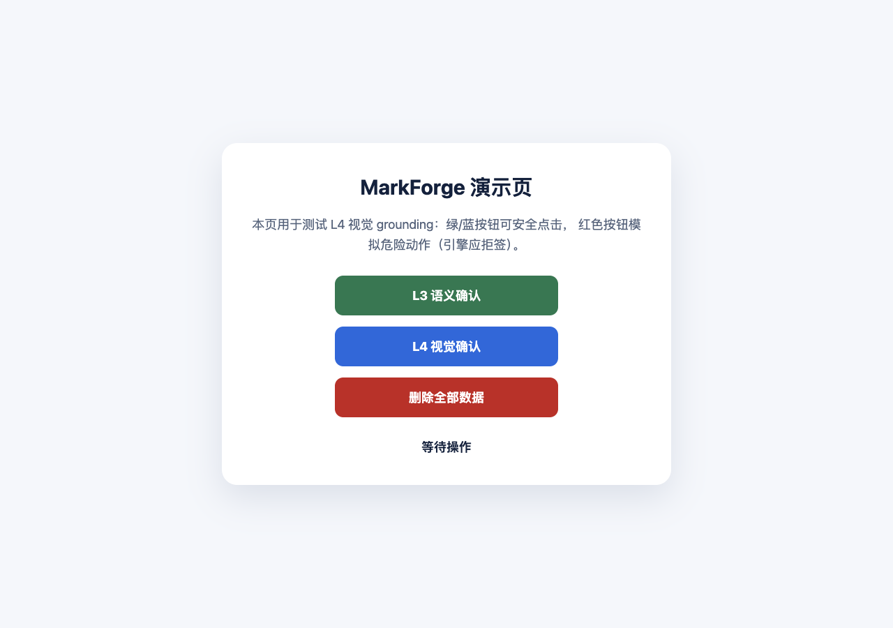
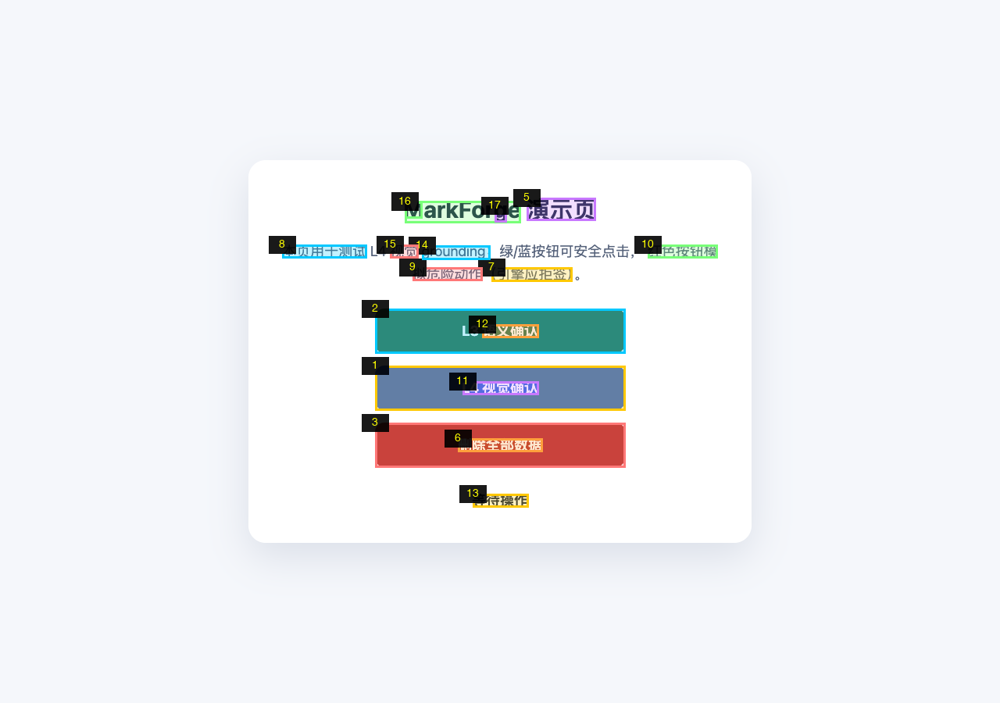

# MarkForge

**Deterministic, auditable visual grounding for GUI agents — zero model downloads.**

MarkForge turns "click that button" into an explainable computation. Given only a
screenshot, it detects candidate interactive elements with classic CV
(connected components + color + geometry), renders **Set-of-Mark** numbered
badges on them, and grounds queries to pixel coordinates.

```bash
python3 -m markforge.cli ground shot.png "color:#1769e0"   # → GROUNDED, centroid (639, 495)
python3 -m markforge.cli ground shot.png "text:Submit"     # → GROUNDED (needs OCR)
python3 -m markforge.cli ground shot.png "#2"              # → SoM badge lookup
```

Unlike VLM-driven clicking (browser-use, Claude computer-use), coordinates here
are **deterministic and replayable** — same input, same output, every decision
carries a machine-readable reason. Unlike model-based parsers (OmniParser,
SeeClick, OS-Atlas), it downloads **nothing**: OpenCV + Pillow is the whole
stack, and an optional OCR backend degrades gracefully to `none`.

## Continuous computer control

MarkForge also supports a persistent **observe → act → verify** loop. Keep the
same app/window or browser page alive, execute a short batch of known actions,
and read the result once rather than taking a screenshot for every keystroke.

- **Computer Use host:** load `scripts/cua-control.mjs` into an existing
  `cua_repl` session. Semantic observations are the default; request screenshots
  only when visual grounding is needed.
- **Standalone macOS:** run a private local worker with
  `bash scripts/control.sh start --session calc --app com.apple.calculator`.
  The host needs Screen Recording and Accessibility permissions.
- **Standalone browser:** use `start --backend browser --url URL` for a
  user-authorized page. Capture and subsequent actions share one owned page.
- Up to 16 actions per batch, cached CV detections within an observed frame,
  Retina coordinate conversion, and explicit partial-failure reporting.

```bash
# Optional macOS input/screenshot dependencies
python3 -m pip install -r requirements-macos.txt

bash scripts/control.sh start --session calc --app com.apple.calculator
bash scripts/control.sh observe --session calc --out /tmp/calc-before.png
# Use the returned frame_id, then inspect the final observation.
bash scripts/control.sh act --session calc --frame-id FRAME_ID \
  --actions '[{"type":"keypress","keys":["1"]},{"type":"keypress","keys":["7"]},{"type":"keypress","keys":["SHIFT","="]},{"type":"keypress","keys":["2"]},{"type":"keypress","keys":["5"]},{"type":"keypress","keys":["ENTER"]}]' \
  --expect-text 42 --out /tmp/calc-after.png
bash scripts/control.sh stop --session calc
```

Select an interpreter with `MARKFORGE_PYTHON` if needed; the launcher recognizes
an active Conda environment and an Anaconda installation in your home directory.
The client uses the standard library; the worker keeps CV/UI imports warm.
Use `--channel msedge` for an installed Edge or `--channel chrome` for an
installed Chrome; leaving the option unset uses bundled Playwright Chromium.

The Computer Use adapter completed six calculator keystrokes (`17 + 25 = 42`)
in 627 ms on the development Mac, including final accessibility-state retrieval
but excluding model inference and outer tool scheduling. This is one smoke test,
not a comparative latency benchmark. Subsequent live tests also passed for standalone macOS input
(`8 × 9 = 72` and `13 + 29 = 42`) and installed Edge (the Selenium public
web form returned `Form submitted / Received!` after a five-action batch).
These smoke tests do not cover every application, browser installation, or site.

See [the controller guide](docs/continuous-control.md) for both APIs and
[SKILL.md](SKILL.md) for reusable agent instructions. The full repository is the
skill bundle; retain its `scripts/` and `markforge/` resources when installing.

## Why

GUI agents that can only *see* (no DOM, no accessibility tree — desktop apps,
VNC, canvas/WebGL) have two mainstream options today, and both give up
auditability:

| Route | Examples | What you lose |
|---|---|---|
| VLM decides everything | browser-use, claude computer-use | Coordinates are unauditable; hallucinated clicks cost real money |
| Dedicated detection models | OmniParser, SeeClick, OS-Atlas | 1–9B weights to download; several repos are unmaintained |

MarkForge fills the empty cell: **classic CV, deterministic scoring, safety
gates**. It is the right tool when the element you want is a solid-color or
outlined control — which covers most buttons, toggles, badges and icons in
real software UIs — and when you need to answer *"why did the agent click
(639, 495)?"* with evidence.

The classic-CV component implements ideas explored by the research community:

- **Set-of-Mark** ([arXiv:2310.11441](https://arxiv.org/abs/2310.11441)) —
  overlay numbered marks so grounding becomes *reference by number*.
- **GUI grounding as the core capability** ([SeeClick, arXiv:2401.10935](https://arxiv.org/abs/2401.10935)) —
  grounding is a separate, testable step, not a side effect of a big model.
- Field survey: [LLM-Brained GUI Agents, arXiv:2411.18279](https://arxiv.org/abs/2411.18279).

Full comparison table (stars/activity checked 2026-10-13 via GitHub API) and
design rationale: [docs/l4-theory.md](docs/l4-theory.md).

## The pipeline

```
screenshot ─→ ①detect ─→ ②ocr(optional) ─→ ③annotate ─→ ④ground ─→ ⑤verify ─→ click
               connected    3 backends,     SoM badges    #N / text: /     fresh-frame
               components   graceful        + JSON        color: / max_area  re-check
               + HSV +      degradation     manifest      deterministic
               Canny edges                 (audit)       scoring
```

### Quickstart

```bash
pip install --index-url https://pypi.org/simple opencv-python-headless pillow
git clone https://github.com/Lannistersyh/MarkForge.git && cd MarkForge

# annotate a screenshot you already have
python3 -m markforge.cli --ocr none annotate your-shot.png --out marked.png

# ground it
python3 -m markforge.cli --ocr auto ground your-shot.png "color:#1769e0"
```

Optional backends: `brew install tesseract` unlocks `text:` queries;
`pip install playwright && playwright install chromium` unlocks screenshot
capture and real clicking.

### Query language

| Query | Meaning | Needs |
|---|---|---|
| `#3` | Click SoM badge №3 (look at the marked image first) | — |
| `text:Submit` | OCR text containment (exact 1.0 / word-level 0.6–0.8) | OCR |
| `color:#1769e0` | Nearest dominant color, **distance cap 80** — absent colors return `NO_MATCH`, never a forced guess | — |
| `max_area` | Largest element (fallback) | — |

When the top two candidates are within 10%, the result is `AMBIGUOUS` and the
runner-up is returned — the caller (human or upper-layer agent) decides, never
a silent pick.

### Safety gates (built into `Engine.click`)

- `status != GROUNDED` → refused (`AMBIGUOUS` is for the caller to resolve)
- text hit contains a dangerous word (delete / submit / purchase / login /
  upload / send …) → refused, unless explicitly overridden *and recorded*
- optional VLM re-check fails → refused
- before every real click, a fresh screenshot is re-detected; if the target
  coordinate no longer falls on a candidate element → **stale-coordinate refusal**
- every decision lands in `eng.last_audit` with a reason string

### Library use

```python
from markforge.engine import Engine

eng = Engine(ocr_backend="auto")            # or "none" for zero-OCR environments
els = eng.detect("shot.png")                # candidate elements
marked = eng.annotate("shot.png", els, "marked.png")
r = eng.ground("color:#1769e0", els)        # GroundResult
if r.status == "GROUNDED":
    verdict = eng.click(r, marked_image=marked["path"], dry_run=True)
    assert verdict["decision"] == "DRY_RUN"
```

### Demo

| Original | SoM-annotated |
|---|---|
|  |  |

Reproduce: `bash scripts/demo.sh` (needs a local HTTP server + a capture
backend; the script falls back to raw CDP via `scripts/cdp-shot.mjs`).

## Tests

```bash
python3 -m pytest tests/markforge/test_core.py tests/markforge/test_session.py -q
node --test tests/cua-control.test.mjs
# 45 Python checks + 4 JavaScript checks; no live desktop input or browser needed
```

Includes 8 regression locks from a self-review that caught five real bugs —
color false-positives, stale-coordinate theater, OCR backend crashes, ghost
elements from duplicate OCR blocks, CLI dead-ends. Details in
[docs/l4-theory.md §6b](docs/l4-theory.md).

## Honest limitations

- Flat/outline-only widgets and icon fonts detect poorly (that is what
  OmniParser's models are for).
- No OCR backend → `text:` queries unavailable (color / badge / geometry still work).
- Photo-like backgrounds produce false candidates; the target scenario is
  software UI, not natural images.
- No ScreenSpot benchmark run yet (planned; see docs).
- Elements larger than 25% of the frame are filtered by design (banners and
  modal overlays are backgrounds, not targets).

## License

MIT — see [LICENSE](LICENSE).
